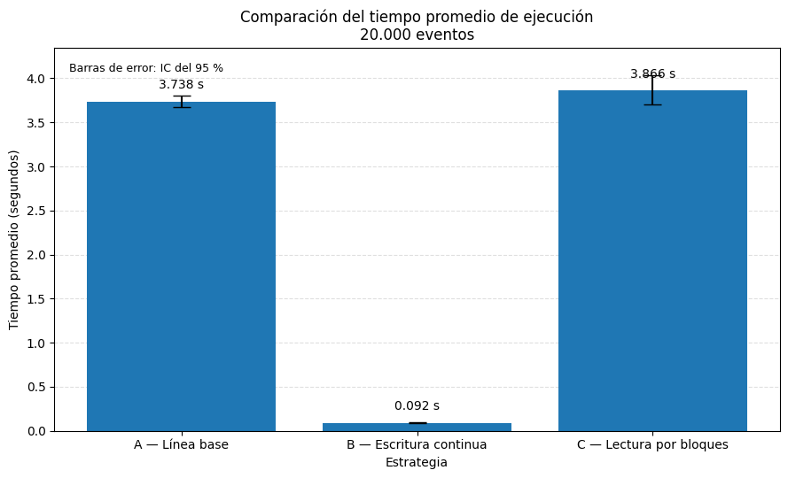

# Informe científico breve — Equipo 6

**Título:** Comparación del rendimiento de estrategias de lectura y escritura de archivos en Python.

**Integrantes:**
- Santiago Grajales
- Narly Sofia Quintero
- David Alejandro Rosales

**Fecha:** 18/11/2026

**Repositorio:** 
https://github.com/sancho0987/trabajo-fisica.git

## Resumen

Se evaluó el rendimiento de tres estrategias de lectura y escritura de archivos en un caso simulado de gestión de registros empresariales. Se procesaron 20.000 eventos en un archivo de aproximadamente 0,93 MB y se realizaron cinco mediciones válidas por estrategia. La estrategia A obtuvo un tiempo promedio de 3,738 s; la estrategia B, que mantiene el archivo abierto durante la escritura, obtuvo 0,092 s; y la estrategia C, que realiza lecturas en bloques de 8192 bytes, obtuvo 3,866 s. La estrategia B redujo el tiempo de ejecución un 97,54 % frente a la línea base, mientras que la estrategia C fue un 3,42 % más lenta. Se concluye que, en las condiciones del experimento, mantener el archivo abierto durante la escritura fue la mejora más efectiva.

## 1. Introducción

DocuArchivo S.A.S. es una empresa simulada dedicada a la custodia y gestión de documentos digitales. En sus procesos se generan registros de auditoría para almacenar las operaciones realizadas. Sin embargo, el procesamiento de estos registros puede tardar demasiado cuando el programa abre y cierra el archivo por cada evento y realiza la lectura byte por byte.

A partir de esta situación, se plantea la siguiente pregunta de investigación:

**¿Cómo cambia el tiempo total de ejecución al modificar los métodos de escritura y lectura de archivos, manteniendo constante la cantidad y el contenido de los eventos procesados?**

El experimento relaciona el rendimiento computacional con las siguientes magnitudes:

- **Tiempo de ejecución (t):** duración del procesamiento, medida en segundos (s).
- **Tamaño de los datos (D):** cantidad de información procesada, medida en megabytes (MB).
- **Velocidad de transferencia (V):** cantidad de información procesada por unidad de tiempo, medida en MB/s.

La relación entre estas magnitudes se expresa mediante:

\[
V=\frac{D}{t}
\]

También puede expresarse el tiempo como:

\[
t=\frac{D}{V}
\]

Estas relaciones permiten analizar cómo cambia el rendimiento cuando se modifica la cantidad de operaciones de lectura y escritura. Reducir operaciones innecesarias puede disminuir el tiempo de procesamiento, aunque el resultado depende de las condiciones del equipo y del sistema.

## 2. Hipótesis

**H1. Optimización del proceso de escritura**

Si se mantiene abierto el archivo durante todo el proceso de escritura, en lugar de abrirlo y cerrarlo por cada evento, entonces el tiempo total de ejecución (s) disminuirá al menos un 20 % respecto a la línea base, porque se reducirán las operaciones de apertura y cierre del archivo y el trabajo adicional que estas generan, manteniendo constantes la cantidad y el contenido de los eventos, el equipo y las condiciones de ejecución.

- **VI:** método de escritura del archivo.
- **VD:** tiempo total de ejecución (s).
- **Predicción cuantitativa:** reducción mínima del 20 %. Tomando como referencia 3,738 s, el tiempo esperado es de aproximadamente 2,99 s o menos.

**H2. Optimización del proceso de lectura**

Si se realiza la lectura del archivo por bloques de 8.192 bytes, en lugar de leer un byte por operación, entonces el tiempo total de ejecución (s) disminuirá al menos un 10 % respecto a la línea base, porque se reducirá la cantidad de operaciones de lectura y el tiempo asociado a ellas, manteniendo constantes la cantidad y el contenido de los eventos, el equipo y las condiciones de ejecución.

- **VI:** método y tamaño del bloque de lectura.
- **VD:** tiempo total de ejecución (s).
- **Predicción cuantitativa:** reducción mínima del 10 %. Tomando como referencia 3,738 s, el tiempo esperado es de aproximadamente 3,36 s o menos.

## 3. Método

### 3.1. Estrategias comparadas

Se evaluaron tres estrategias de procesamiento de archivos:

- **Estrategia A — Línea base:** abre y cierra el archivo por cada evento y realiza la lectura byte por byte.
- **Estrategia B — Escritura continua:** mantiene el archivo abierto durante todo el proceso de escritura y utiliza `writelines()` para escribir los eventos.
- **Estrategia C — Lectura por bloques:** conserva el método de escritura de la línea base y modifica la lectura para procesar bloques de 8192 bytes.

### 3.2. Variables experimentales

- **Variable independiente (VI):** estrategia de lectura y escritura utilizada.
- **Variables dependientes (VD):**
  - Tiempo total de ejecución, medido en segundos (s).
  - Velocidad de transferencia calculada, medida en MB/s.
- **Variables controladas (VC):**
  - Cantidad de eventos: 20.000.
  - Semilla de generación: 6.
  - Contenido y tamaño del archivo: aproximadamente 0,93 MB.
  - Mismo computador para comparar las estrategias con su respectiva línea base
  - Versión de Python y condiciones de ejecución.
  - Estado de caché: lectura en caliente, inmediatamente después de la escritura.

### 3.3. Entorno experimental

El experimento se ejecutó en Windows utilizando Python y Visual Studio Code. Durante el registro de las condiciones del equipo se indicó que el computador estaba conectado a la corriente y que se encontraban abiertos Visual Studio Code y Google Chrome con seis pestañas.

La temperatura del equipo y la energía mediante RAPL no se registraron, por lo que no se utilizaron como variables medidas.

### 3.4. Instrumentos y mediciones

Se utilizó el computador y los programas desarrollados en Python para ejecutar las estrategias y registrar los tiempos de procesamiento, el tamaño de los archivos y la cantidad de datos leídos.

Los tiempos se registraron con una precisión de dos decimales en las ejecuciones. Los promedios y coeficientes de variación se calcularon a partir de las cinco mediciones válidas de cada estrategia.

### 3.5. Protocolo experimental

Para cada estrategia se realizó una ejecución de calentamiento y posteriormente cinco mediciones válidas. Se mantuvieron los mismos 20.000 eventos, la semilla 6 y el contenido del archivo.

Se verificó que cada estrategia procesara las 20.000 líneas y el mismo tamaño de archivo. Además, se comprobó que el coeficiente de variación de las mediciones fuera inferior al 10 %.

Las comparaciones entre estrategias se realizaron en el mismo computador y bajo condiciones de ejecución equivalentes. La lectura se efectuó inmediatamente después de la escritura, por lo que los datos se encontraban en caché.

## 4. Resultados

### 4.1. Resultados de las mediciones

Se realizaron cinco mediciones válidas por estrategia, después de una ejecución de calentamiento. Todas procesaron 20.000 eventos y un archivo de aproximadamente 0,93 MB.

| Estrategia | Media (s) | Desviación estándar (s) | CV (%) | IC 95 % (s) | n |
|---|---:|---:|---:|---:|---:|
| A — Línea base | 3,738 | 0,053 | 1,42 | [3,672; 3,804] | 5 |
| B — Escritura continua | 0,092 | 0,004 | 4,86 | [0,086; 0,098] | 5 |
| C — Lectura por bloques | 3,866 | 0,133 | 3,45 | [3,701; 4,032] | 5 |

Los intervalos de confianza del 95 % se calcularon utilizando la distribución t de Student. La desviación estándar corresponde a la muestra.

### 4.2. Velocidad de transferencia

| Estrategia | Velocidad promedio aproximada |
|---|---:|
| A — Línea base | 0,25 MB/s |
| B — Escritura continua | 10,09 MB/s |
| C — Lectura por bloques | 0,24 MB/s |

### 4.3. Comparación de estrategias

La estrategia B presentó el menor tiempo promedio, con 0,092 s, mientras que la estrategia C obtuvo 3,866 s y la línea base 3,738 s.

En comparación con la línea base, la estrategia B redujo el tiempo de ejecución aproximadamente un 97,54 %. Por su parte, la estrategia C presentó un aumento aproximado del 3,42 %.

### 4.4. Gráficos

- **Gráfico 1. Tiempo frente a cantidad de eventos:** no se elaboró porque las mediciones disponibles corresponden únicamente a un tamaño de entrada: 20.000 eventos. No hay datos suficientes para construir una gráfica log-log.
- **Gráfico 2. Comparación de estrategias para 20.000 eventos:** se deben representar los tiempos promedio de A (3,738 s), B (0,092 s) y C (3,866 s), incluyendo sus barras de error correspondientes a los intervalos de confianza del 95 %.

### 4.5. Otras magnitudes

No se realizaron mediciones directas de consumo energético, temperatura ni utilización de CPU. Por tanto, estas magnitudes no se incluyen como resultados experimentales.

## 5. Discusión

### 5.1. Comprobación de las hipótesis

**H1. Optimización del proceso de escritura — Cumplida.**

La hipótesis establecía que mantener abierto el archivo durante la escritura reduciría el tiempo de ejecución al menos un 20 %. La estrategia B obtuvo un promedio de 0,092 s frente a los 3,738 s de la línea base, lo que representa una reducción aproximada del 97,54 %. Por lo tanto, se superó la reducción mínima esperada.

**H2. Optimización del proceso de lectura — Refutada.**

La hipótesis establecía que leer el archivo en bloques de 8192 bytes reduciría el tiempo total al menos un 10 %. Sin embargo, la estrategia C obtuvo un promedio de 3,866 s, aproximadamente un 3,42 % más que la línea base. Por tanto, la predicción no se cumplió.

### 5.2. Explicación de los resultados

La estrategia B presentó una mejora considerable porque mantuvo el archivo abierto durante el proceso de escritura, evitando repetir las operaciones de apertura y cierre para cada evento. Esto redujo el trabajo adicional asociado a esas operaciones y, por consiguiente, el tiempo total de ejecución.

En la estrategia C se redujo la cantidad de operaciones de lectura al procesar bloques de 8192 bytes. Sin embargo, esta modificación no produjo una mejora en el tiempo total del programa. Una posible explicación es que el tiempo empleado en otras partes del proceso, especialmente en la escritura que se mantuvo igual a la línea base, influyó en el resultado.

### 5.3. Limitaciones y amenazas a la validez

- Solo se evaluó un tamaño de entrada: 20.000 eventos y aproximadamente 0,93 MB.
- Las lecturas se realizaron en caliente, inmediatamente después de la escritura, por lo que los datos podían encontrarse en la caché del sistema operativo.
- No se midieron directamente el consumo energético, la temperatura ni el porcentaje de uso de CPU.
- Las condiciones del equipo y los procesos del sistema operativo pueden influir en los tiempos de ejecución.
- Los resultados se obtuvieron en las condiciones específicas del experimento y no garantizan el mismo rendimiento en todos los computadores.

A pesar de estas limitaciones, las cinco mediciones válidas de cada estrategia presentaron coeficientes de variación inferiores al 10 %, lo que indica una variabilidad relativamente baja en las ejecuciones realizadas.

## 6. Propuesta de mejora para la empresa

Se recomienda a DocuArchivo S.A.S. implementar la estrategia B, que consiste en mantener abierto el archivo durante todo el proceso de escritura, en lugar de abrirlo y cerrarlo por cada evento.

Esta recomendación se basa en los resultados del experimento, en el que la estrategia B obtuvo un tiempo promedio de 0,092 s frente a los 3,738 s de la línea base, logrando una reducción aproximada del 97,54 %.

**Condiciones de aplicación:**

- Mantener el archivo abierto mientras se procesan los eventos.
- Conservar la verificación de que los registros se escriban correctamente.
- Aplicar la estrategia en procesos que realicen múltiples escrituras sobre un mismo archivo.

**Riesgos y consideraciones:**

Mantener el archivo abierto durante más tiempo requiere asegurar su cierre correcto al finalizar el proceso, incluso si ocurre un error. Además, se deben realizar pruebas con volúmenes mayores de información antes de implementar la mejora en un entorno real.

La reducción obtenida corresponde a las condiciones específicas del experimento y no debe asumirse como un resultado garantizado para todos los equipos o volúmenes de datos.

## 7. Conclusiones

1. La estrategia B fue la más eficiente en las condiciones del experimento, con un tiempo promedio de 0,092 s y una reducción del 97,54 % respecto a la línea base.

2. La hipótesis H1 se cumplió, ya que mantener abierto el archivo durante la escritura permitió superar la reducción mínima del 20 % esperada.

3. La hipótesis H2 fue refutada, porque la lectura por bloques de 8192 bytes no disminuyó el tiempo total de ejecución; por el contrario, presentó un aumento aproximado del 3,42 % frente a la línea base.

4. Se comprobó que reducir la cantidad de operaciones de apertura y cierre puede mejorar significativamente el rendimiento del procesamiento de archivos.

5. Los resultados corresponden a un archivo de aproximadamente 0,93 MB y 20.000 eventos. Se recomienda realizar nuevas pruebas con diferentes tamaños de entrada antes de aplicar estas optimizaciones a procesos reales de la empresa.

## 8. Referencias

- Guía de trabajo de la actividad: Física Aplicada al Desarrollo de Software, SENA.
- Documentación oficial de Python: https://docs.python.org/3/